# Architecture

This document explains how Agents Office is put together and how data moves through it, so you can tell where a change belongs. For setup, scripts and the release procedure see [DEVELOPMENT.md](./DEVELOPMENT.md). For the visual and UI conventions (viewport, zoom, characters, panels) see [DESIGN.md](./DESIGN.md).

Agents Office mirrors Claude Code activity as a pixel art office. It reads what Claude Code writes to disk (transcripts) and what it sends to hooks, turns that into a canonical event stream, and renders the result. The desktop app adds embedded terminals running `claude`, agent profiles and rosters, an agent-to-agent message bus, and a whiteboard.

Status legend used below: items marked **in progress** exist in the working tree but are not finished or released yet (the embedded browser and its approval prompts). Everything else is implemented.

- [Packages](#packages)
- [Processes](#processes)
- [Shared contracts](#shared-contracts)
- [Flows](#flows)
- [Release, auto-update and CI](#release-auto-update-and-ci)
- [Security](#security)
- [Where does my change go?](#where-does-my-change-go)

## Packages

The repository is a pnpm workspace (`packages/*` and `e2e`).

| Package | Name | Role |
| --- | --- | --- |
| `packages/shared` | `@agents-office/shared` | Zod schemas and types shared by every other package: events, model, reducer, WebSocket protocol, permission messages, and the `desktop*` bridge contracts. No runtime dependency except `zod`. |
| `packages/daemon` | `@agents-office/daemon` | Fastify server, transcript watcher, normalizer, liveness tick, permission broker, and the `agents-office` CLI (`start`, `hooks`, `hook`). |
| `packages/web` | `@agents-office/web` | Phaser 3 game plus DOM UI (panels, xterm.js terminal, Excalidraw whiteboard). Runs in a browser or inside the desktop window. |
| `packages/desktop` | `@agents-office/desktop` | Electron shell: main process, preload bridges, embedded `node-pty` terminals, agent bus, updater. |
| `packages/cli` | `agents-office` | The publishable npm package. Bundles the daemon and the built web app (`bin/agents-office.mjs`, `dist/cli.mjs`, `dist/hook.mjs`, `dist/web`). |
| `e2e` | `@agents-office/e2e` | Playwright tests against the daemon and web build, and against the packaged desktop app. |

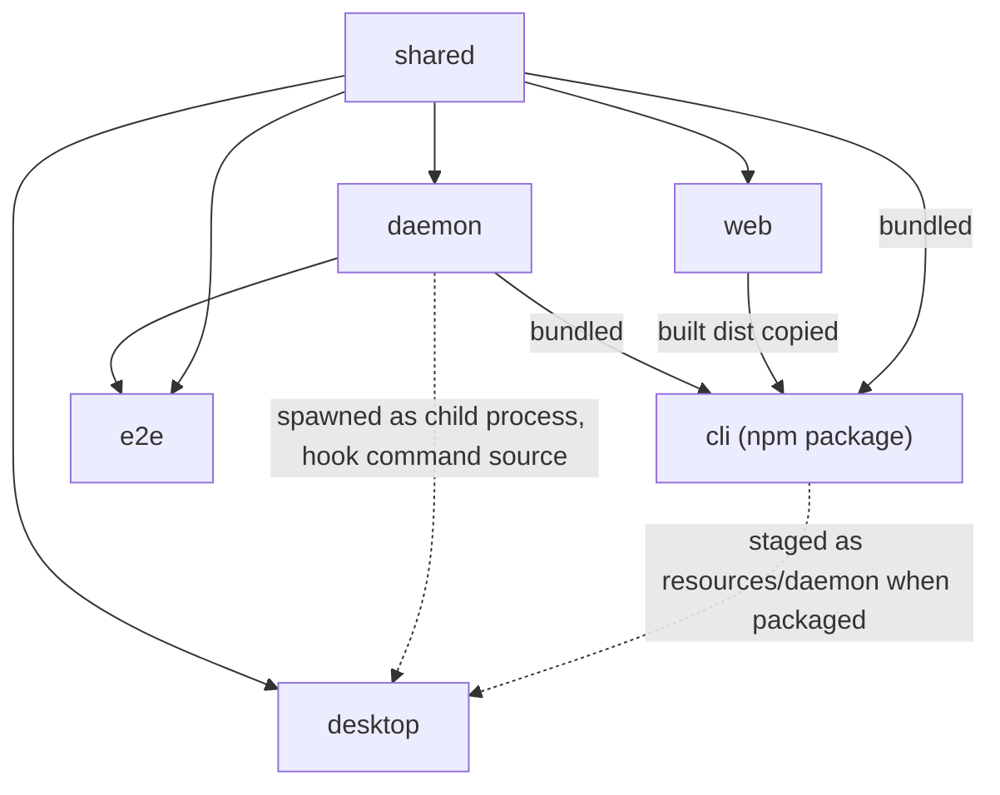

Notes on the edges:

- `web`, `daemon` and `desktop` never import each other's runtime code through the workspace. They meet in `shared`. Two deliberate exceptions: `desktop` imports the pure hook settings merger from `packages/daemon/src/cli/settings-merger.ts` by relative path (the app installs hooks with the same code as `agents-office hooks`), and the `cli` build bundles daemon and web output.
- The desktop app does not embed the daemon in-process. It runs the `agents-office` entry as a child process (see [Processes](#processes)), so the desktop and the standalone CLI use the very same daemon.
- `web` bridges to the desktop only through `window.agentsOfficeDesktop`, a typed surface defined in `shared` and implemented in `desktop/src/preload`. The web code must feature-detect it, because the same bundle also runs in a plain browser against the standalone daemon.

## Processes

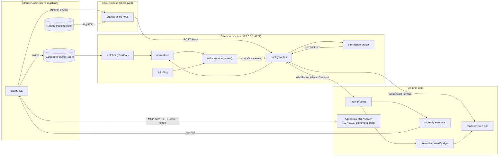

### Daemon (`packages/daemon`)

One Node process, bound to `127.0.0.1` (default port `4777`, `AGENTS_OFFICE_PORT` or `--port`). The server refuses a non-loopback host unless `--unsafe-host` is given. Routes:

| Route | Purpose |
| --- | --- |
| `GET /health` | `{ ok, version, sessions, agents, pendingPermissions, hooksSeenAt? }`. The desktop app probes it to decide whether to start its own daemon. |
| `POST /hook` | Receives a Claude Code hook payload (validated with `HookPayloadSchema`). Answers `204` immediately and ingests asynchronously. A `PermissionRequest` is only tracked by the broker, never normalized. |
| `POST /hook/permission` | Legacy route from older hooks. Tracks the request and answers `204` at once, so an old hook can never hold a terminal prompt. |
| `GET /stream` (WebSocket) | Sends a `snapshot` of the model, then every `event`. With `?role=ui` the client also receives `permission.snapshot`, `permission.requested` and `permission.resolved`. Client messages are ignored. |
| `GET /skin/*` | Files of an external skin given with `--skin`; `404` otherwise. |
| `GET /*` | Static files of the built web app (SPA fallback), `404` if the web app is not built. |

Internal pieces:

- **Watcher** (`watcher/`): chokidar over `~/.claude/projects` (override with `--projects-dir`). `classifyPath` maps `<slug>/<sessionId>.jsonl` to a session transcript, `<slug>/<sessionId>/subagents/agent-<id>.jsonl` to an agent transcript, and `agent-<id>.meta.json` to agent metadata. It reads appended bytes per file with a short debounce and only loads files modified within the initial window (15 min) on startup.
- **Normalizer** (`normalizer/`): converts transcript lines, agent metadata and hook payloads into canonical `OfficeEvent`s. It never throws, deduplicates re-read lines, and keeps counters. Hook events carry no timestamp, so the daemon stamps them with their receive time. A hook payload carrying `terminalId` yields `session.bound`.
- **Reduce** (`shared/reducer.ts`): the pure function `reduce(model, event)`. The daemon applies it to its model and the web client applies the same function to the events it receives.
- **Tick / liveness** (`model/liveness.ts`): every 5 s the daemon calls `tick(model, now)`, which emits the time-based events: an actor silent for 2 min goes idle, an idle agent silent for 5 min finishes, and a session silent for 15 min ends with `reason: 'expired'`. The clock is injected, so the logic is deterministic in tests.
- **Permission broker** (`server/permissionBroker.ts`): a notify-only tracker, see [Permission notifications](#permission-notifications-notify-only).

### Hook CLI

`agents-office hook` is the command registered in `~/.claude/settings.json` for every hook event (`SessionStart`, `SessionEnd`, `SubagentStart`, `SubagentStop`, `PreToolUse`, `PostToolUse`, `Notification`, `Stop`, `UserPromptSubmit`, `PermissionRequest`). It is intentionally dependency-free so it starts fast: it reads stdin (up to 1 MiB), adds `terminalId` from `AGENTS_OFFICE_TERMINAL_ID` when set, and `POST`s to `http://127.0.0.1:<port>/hook` with a 300 ms budget. Any failure is swallowed and the process exits 0, so Claude Code is never disturbed. It never writes to stdout and never exits with 2: the permission prompt is always answered in the terminal.

`agents-office hooks install|uninstall|status` edits `settings.json` through the settings merger (with `--dry-run` and a diff).

### Electron main (`packages/desktop/src/main`)

`main.ts` wires everything together. Its responsibilities:

- **Single instance and daemon lifecycle.** `DaemonController` probes `/health` first. If an Agents Office daemon already answers, the app connects to it (`external`); if another program holds the port it shows an error (`port-busy`); otherwise it forks the daemon with `utilityProcess` and restarts it with backoff if it dies. Daemon entry resolution (`daemonEntry.ts`): `AGENTS_OFFICE_DAEMON_ENTRY`, then `resources/daemon/bin/agents-office.mjs` when packaged, then the repository's CLI or daemon in development.
- **Window.** A `BrowserWindow` with `contextIsolation`, `sandbox` and no `nodeIntegration` loads the web app from the daemon origin (`http://127.0.0.1:<port>/`). Navigation is classified (`navigation.ts`): same origin is allowed, other http(s) URLs open in the system browser, everything else is denied.
- **Terminals.** `SessionManager` spawns `claude` (or a given command) under `node-pty`, with a ring buffer per session, a session limit, and a cleaned environment. `SessionRegistry` persists which terminals were open so lost sessions can be offered again.
- **Managed sessions, profiles and roster.** `ProfileLibrary`, `RosterStore` and `ManagedSessions`, see [Managed sessions, profiles and roster](#managed-sessions-profiles-and-roster).
- **Agent Bus.** The MCP server and its tools, see [Agent Bus](#agent-bus-mcp).
- **Permission watcher and notifications.** `PermissionWatcher` follows `ws://127.0.0.1:<port>/stream?role=ui`, `PermissionTracker` keeps the pending ids, and the shell raises or closes system notifications. The tray and app menu live in `shell.ts`.
- **Updater and quit flow.** See [Release, auto-update and CI](#release-auto-update-and-ci).
- **Persistence** under Electron's `userData` directory: `config.json`, `sessions.json`, `projects.json`, `rosters.json`, `profiles/`, `spawn-approvals.json`, `spawn-audit.json`, `boards/`, `board-libraries/`, `editor.json`. Writes are atomic (temp file plus rename) and a corrupt file is moved aside and replaced by an empty one.

### Preload and renderer

The preload exposes exactly one global, `window.agentsOfficeDesktop`, with `contextBridge.exposeInMainWorld`. It never exposes `ipcRenderer`. Each namespace is built by a small bridge factory around `invoke`/`subscribe` and typed by a contract in `shared`:

| Namespace | Contract in `shared` | Channel prefix |
| --- | --- | --- |
| `hooks` | `desktopHooks.ts` | `agents-office:hooks:` |
| `projects` | `desktopProjects.ts` | `agents-office:projects:` |
| `profiles` | `desktopProfiles.ts` | `agents-office:profiles:` |
| `managed` | `desktopManaged.ts` | `agents-office:managed:` |
| `comms` | `desktopComms.ts` | `agents-office:comms:` |
| `board` | `desktopBoard.ts` | `agents-office:board:` |
| `browser` (in progress) | `desktopBrowser.ts` | `agents-office:browser:` |
| `browserApproval` (in progress) | `desktopBrowserApproval.ts` | defined in the working tree |
| `spawnApproval` | `desktopSpawnApproval.ts` | `agents-office:spawn-approval:` |
| `external` | `desktopExternal.ts` | `agents-office:external:` |
| `terminal` | `desktopTerminal.ts` | `agents-office:terminal:` |
| `updater` | `desktopUpdater.ts` | `agents-office:updater:` |

Channel names live in `desktop/src/main/*Channels.ts` and are imported by both the main process and the preload, so the two sides cannot drift. Every handler runs `trusted(event)` first (the sender must be the office window and its frame URL must be on the daemon origin) and parses its arguments with zod, rejecting extra properties.

The interface language is purely a renderer concern: `packages/web/src/i18n` holds the dictionaries (`en`, `pt-BR`, `es`) and the `t()` helper, and the choice lives in the browser's `localStorage` (`agents-office.locale`). It does not cross the preload bridge or `shared`. Text produced only in the Electron main process (tray, system notifications, quit dialog) is not translated yet.

The renderer is the web app: Phaser draws the office from the model, and DOM panels (terminals, cast panel, whiteboard, update banner) talk to the desktop through the bridge.

## Shared contracts

Everything crossing a process boundary is defined once in `packages/shared/src` and validated with zod.

| File | Contents |
| --- | --- |
| `events.ts` | `OfficeEvent`, a discriminated union on `type`: `session.started`, `session.bound`, `agent.spawned`, `agent.updated`, `tool.started`, `tool.finished`, `actor.thinking`, `actor.waiting`, `actor.idle`, `agent.finished`, `session.ended`, `usage`. Each event has a `source` of `jsonl`, `hook` or `clock`. |
| `model.ts` | `OfficeModel`: `projects` (rooms), `sessions` (the Tech Lead of a project) and `agents` (subagents) in flat maps keyed by id, plus `hallOfFame` (the last 20 finished agents). Also `ActorStatus`, `Step`, `Usage`, `Profession`. |
| `reducer.ts` | The pure `reduce(model, event, options)`. Immutable and replay-safe. Keeps `RECENT_STEPS_LIMIT` (5) steps per actor and `HALL_OF_FAME_SIZE` (20). |
| `professions.ts` | The default table mapping agent types to professions, its override format (`professions.json`) and `resolveProfession`. |
| `protocol.ts` | `ServerMessage` (the WebSocket union: `snapshot`, `event`, and the three `permission.*` messages), `HookPayloadSchema` (tolerant: only `hook_event_name` and `session_id` are required), `KNOWN_HOOK_EVENTS`. |
| `permissions.ts` | `PermissionRequest` (carries a short `inputSummary`, never the raw tool input) and the `permission.requested`, `permission.resolved`, `permission.snapshot` messages. |
| `desktop*.ts` | Bridge contracts for the desktop surface (see the table above) plus shared limits, for example `PROFILE_INSTRUCTIONS_MAX`, `AGENT_NOTES_MAX`, `ROSTER_MAX_ENTRIES`, `SPAWN_TASK_MAX`, `COMM_HISTORY_MAX`. |

`session.bound` is how the app links an embedded terminal tab to a Claude Code session: the hook adds `AGENTS_OFFICE_TERMINAL_ID` to the payload as `terminalId`, and the normalizer emits `session.bound`, which sets `Session.terminalId` in the model.

Rules of thumb:

- A new event type goes in `events.ts`, the normalizer that produces it, and a `case` in `reducer.ts`. Keep `reduce` pure.
- A new desktop capability needs a contract in `shared`, a channel file and handler in `desktop/src/main`, a bridge in `desktop/src/preload`, and a registration in `preload/index.ts`.
- Unknown fields are preserved on events and hook payloads (`looseObject`), because the Claude Code hook and transcript formats are not a stable public API.

## Flows

### Transcript to the browser

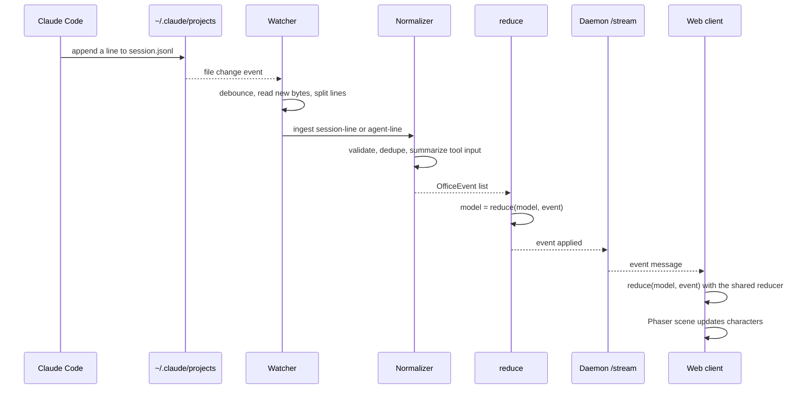

On connect, the web client receives a `snapshot` (full model) and then only `event`s. If the socket drops it reconnects with a delay that starts at 1 s and doubles up to 10 s, and the next snapshot replaces its model. The daemon `tick` feeds the same `reduce`, so idle, finished and expired states arrive as ordinary events.

### Hooks

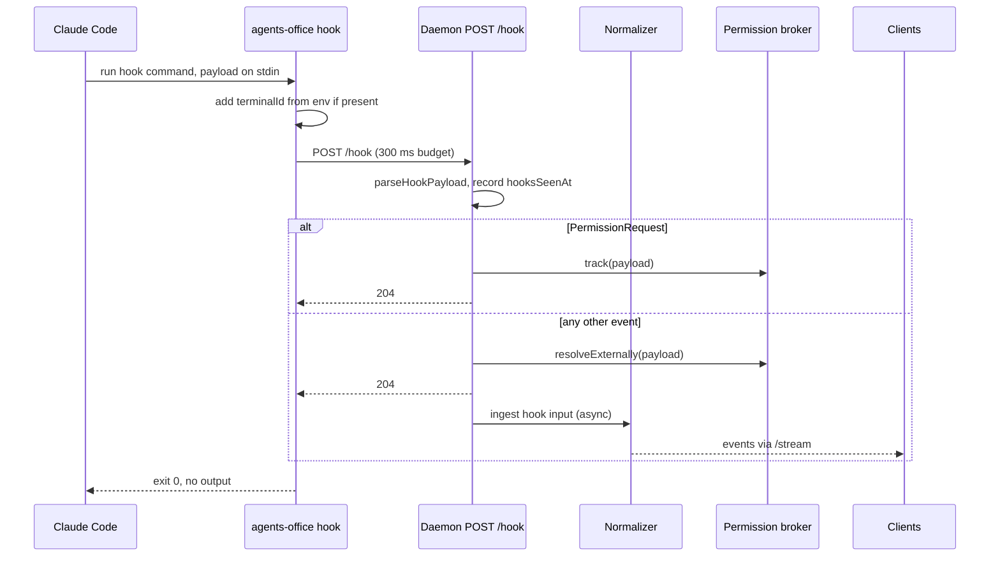

Hooks and transcripts complement each other: transcripts give the history and tool details, hooks give low-latency lifecycle signals (session start and end, subagent start and stop, prompt submitted, `Stop`) and the terminal link.

### Permission notifications (notify-only)

The original idea was a card that approves or denies a tool call from the UI. Spike 013 refuted its central premise: the terminal prompt appears immediately and in parallel with the hook, the hook cannot hold it, and a hook that is killed or times out simply leaves the prompt in place. So the design is **notify-only**: the app tells the user that an agent is waiting, and the answer is always given in the terminal. Details are in `.claude/learnings/permission-hook-and-pty.md` and `.claude/learnings/permission-notify-only.md`.

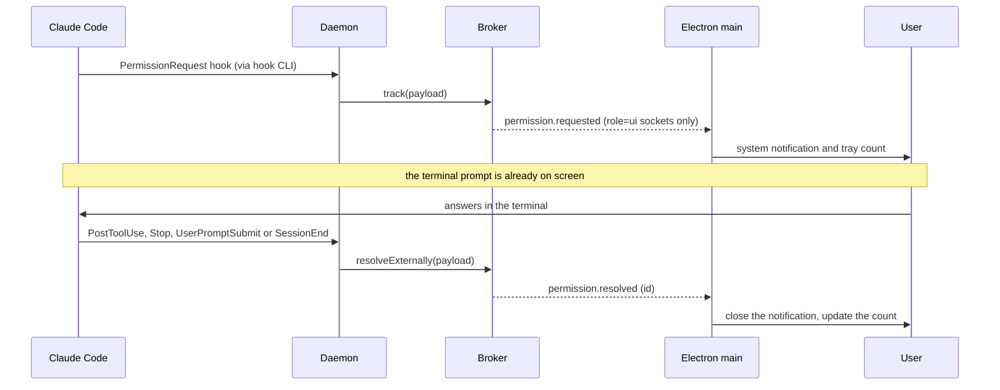

- The pending request is correlated with later events by `session_id`, `agent_id`, `tool_name` and the stable-stringified `tool_input` (a `PermissionRequest` has no `tool_use_id`). The raw tool input stays in memory only and is never logged or sent to the UI.
- Resolution events: `PostToolUse`, `PostToolUseFailure` and `PermissionDenied` for the matching tool; `Stop`, `UserPromptSubmit` and `SessionEnd` for the whole session.
- The request is `agent_id ?? session_id` based: no `agent_id` means the Tech Lead.
- Only `role=ui` sockets receive permission messages. The desktop reconnects, and `PermissionTracker` turns a dropped connection or a fresh snapshot into resolved ids, so no notification is left orphaned.
- Permission modes that auto-approve (for example `auto` or `bypassPermissions`) never emit a `PermissionRequest`, so there is nothing to notify.

### Terminal sessions

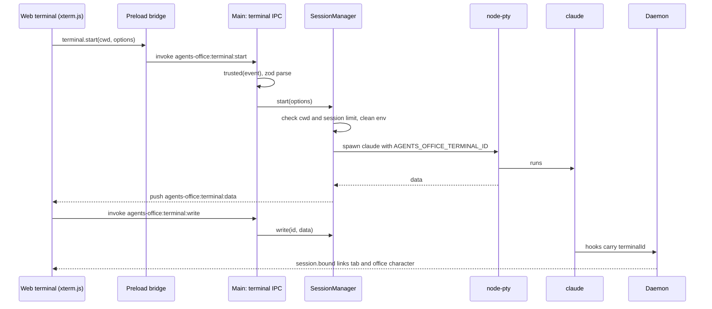

Details worth knowing:

- The renderer only sees terminal ids and bytes, never `node-pty`. Terminal data is not logged.
- `cleanClaudeEnv` removes `CLAUDECODE`, `CLAUDE_CODE_*` (except `CLAUDE_CODE_USE_*` and `CLAUDE_CODE_SKIP_*`), `CLAUDE_EFFORT` and `CLAUDE_PID`. If the app itself was started from a Claude Code session, those variables make the child `claude` stop saving its transcript, and the session would never appear in the office.
- The pty gets `AGENTS_OFFICE_TERMINAL_ID` (and `AGENTS_OFFICE_PROFILE_ID`, `AGENTS_OFFICE_PROJECT_ID` for managed sessions). Hooks are children of `claude`, so they inherit it.
- The `claude` binary is resolved outside an interactive shell by `BinaryResolver`, which can ask the login shell for its PATH. The user can set an explicit path in settings.
- Output is kept in a ring buffer so a reloaded window can fetch it with `terminal:buffer`. Terminal sessions are registered in `sessions.json`; sessions left over from a previous run show up as lost sessions that can be resumed.
- Typing in a terminal also resets the agent message circuit breaker for that project (see below).

### Managed sessions, profiles and roster

A **profile** (`AgentProfile`) is a reusable agent definition: name, description, appearance, instructions, permission mode, model and role (`padrao` or `orquestrador`). Profiles live in a global library under `userData/profiles/`, seeded with `tech-lead`. A project's **roster** (`rosters.json`) lists the entries (a reference to a profile, or an inline agent created by an orchestrator), their connections, notes and an `autoReopen` flag.

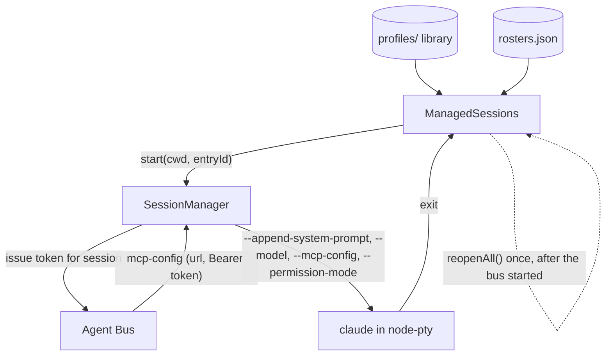

- `ManagedSessions.start` is idempotent per `(cwd, entryId)`, never uses `--resume`, and tracks which terminal runs which entry. `reopenAll()` runs once at startup after the Agent Bus is listening, honors `autoReopen` and the session limit, and a failing entry does not block the next (`ReopenReport`).
- The injection of `--append-system-prompt`, `--model` and `--mcp-config` only happens when no explicit `command` was given (a real `claude`). Instructions are appended to the project's own `CLAUDE.md`, not replacing it. If the bus is not listening, the session starts without MCP rather than failing.
- Sessions opened from the project picker are "external": they still appear in the office through hooks and transcripts but are not managed.
- Editing a profile applies on the next start of its session.

### Agent Bus (MCP)

The Agent Bus is a minimal MCP server (JSON-RPC 2.0 over `POST /mcp`, no SDK) inside the Electron main process. It listens on `127.0.0.1` on an ephemeral port. Every managed `claude` session gets its own random 32-byte Bearer token, compared in constant time and revoked when the session ends. The token binds the call to a `BusSession` (`sessionId`, `entryId`, `cwd`, `role`), so a tool always knows who is calling. Bodies are capped at 256 KiB. Tools can be restricted to roles.

| Tool | Roles | Purpose |
| --- | --- | --- |
| `save_notes` | all | Store the agent's notes in the roster (up to `AGENT_NOTES_MAX` characters). |
| `list_agents` | all | Connected agents of the caller with their state (`ocioso`, `ocupado`, `desligado`) and queued count. |
| `send_message` | all | Queue a message to a connected agent by name or id. |
| `reply` | all | Answer a received message by `message_id`. |
| `spawn_agent` | `orquestrador` | Create an inline agent and start its session, after user approval. |
| `dismiss_agent` | `orquestrador` | End and remove an agent the orchestrator created. |
| `board_read`, `board_add_elements`, `board_add_mermaid`, `board_clear`, `board_list_library`, `board_add_library_item` | all | Read and draw on the project whiteboard. |
| `browser_navigate`, `browser_click`, `browser_type`, `browser_press_key`, `browser_eval`, `browser_snapshot`, `browser_screenshot`, `browser_console`, `browser_wait_for` | all | Drive the embedded browser. **In progress**, see [Embedded browser](#embedded-browser-in-progress). |

#### Message queue and circuit breaker

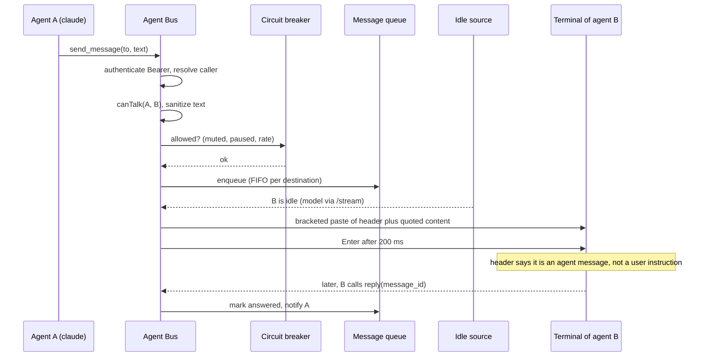

- **Connections gate messaging.** Agents can only talk to roster entries they are connected to (`RosterStore.canTalk`), and the destination must have a running session.
- **Delivery is typed into the destination terminal**, as a bracketed paste followed by Enter 200 ms later. Text is stripped of control characters (an ESC could close the paste early) and capped (`MESSAGE_TEXT_MAX` 4000, `MESSAGE_CONTEXT_MAX` 1000). The first line is a fixed header stating the content is a message from an agent and not a user instruction; the content is quoted line by line.
- **One message at a time per destination.** A destination is idle when its session in the office model has status `idle`. The main process has no model of its own, so `OfficeIdleSource` follows the daemon `/stream` and applies the shared `reduce`. After a delivery the destination is not fed again until it was seen busy and idle again, or `SETTLE_MS` (15 s) passes.
- **Queue limits** (`messageQueue.ts`): `MESSAGE_QUEUE_MAX` 20 per destination, `MESSAGE_TTL_MS` 30 min, `MESSAGE_HISTORY_MAX` 200. The queue is memory only and dropped when the app closes. States: `na-fila`, `entregue`, `respondida`, `expirada`.
- **Circuit breaker** (`circuitBreaker.ts`): counts messages chained since the user last typed in a terminal of the project and pauses deliveries at `HOP_LIMIT` 8; allows `RATE_LIMIT` 10 messages per sender per `RATE_WINDOW_MS` (60 s); and keeps a muted set (a muted agent cannot send or receive). Typing in a project terminal (IPC `terminal:write`, ignoring data that starts with ESC) resets the hops and resumes. When the limit is hit, the app notifies and offers Continue or End. The bridge is `profiles.comms.{status, mute, resume, stop}`.
- **Visibility.** `CommsLog` subscribes to queue events and keeps a per-project history (`COMM_HISTORY_MAX` 100). Events are pushed to the window (`agents-office:comms:event`); the office scene turns them into characters visiting each other's desks.

#### Orchestrator spawn approval

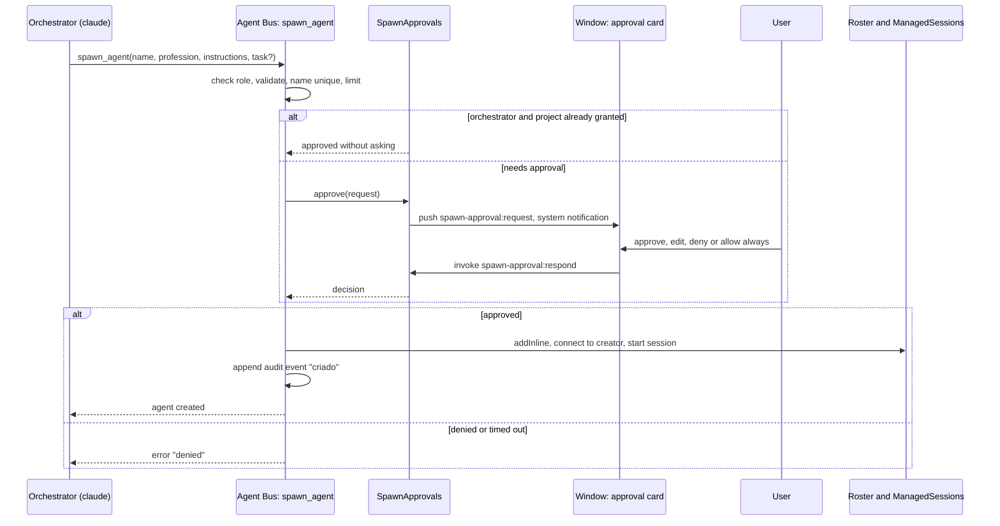

- Only sessions with role `orquestrador` see `spawn_agent` and `dismiss_agent`, and the handlers re-check the role. Created agents are inline roster entries with role `padrao` (no recursion), auto-connected to their creator. `SPAWN_LIMIT` is 2 live agents per orchestrator, and the limit check and the roster insert happen without an `await` in between, so parallel calls cannot exceed it.
- **Fail closed.** Only an explicit approval creates an agent. A denial, `SPAWN_APPROVAL_TIMEOUT_MS` (5 min) expiring, closing the app, or a missing `entryId` all deny. Edited instructions come back and are validated again.
- The "allow without asking" grant is stored in `spawn-approvals.json` as `{cwd, orchestratorId}` pairs. A missing or corrupt file means ask again.
- The creator's instructions are prefixed in the new agent's system prompt as written by the creating agent. The audit log (`spawn-audit.json`, 500 events) records `criado` and `encerrado`. A created agent can later be saved as a library profile.

### Whiteboard (Excalidraw)

Each project has a whiteboard: an Excalidraw scene shown as an overlay in the window and editable by both the user and agents.

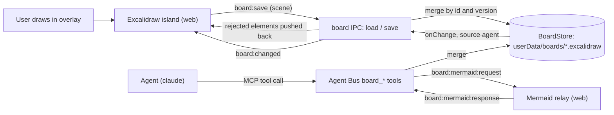

- `BoardStore` keeps one `.excalidraw` file per project, with atomic writes, a `.bak` of the last valid version, and recovery (`recovered` or `lost`) for corrupt files. Limits: 2000 live elements, 5 MB, 500 tombstones; exceeding them throws without writing.
- Both sides write through `merge`, which reconciles by element id and `version` (a tie goes to the lower `versionNonce`). Deletions are tombstones. Changes made by agents are pushed to the window with `board:changed`; elements of a user save that lost the merge are sent back so the window converges.
- Agents author elements with `customData.author`; `board_clear` clears only the caller's own elements by default and `scope: 'all'` needs a confirmation dialog in the main process (denied if absent).
- `board_read` wraps the scene JSON in `<board-data>` markers with a warning that it is data, not instructions.
- Mermaid conversion needs a DOM, so the main process asks the window (`board:mermaid:request` and `board:mermaid:response`, 15 s timeout, `unavailable` if no window answers). Shape libraries (`.excalidrawlib`) are imported and listed through `board:libraries:*` and stored in `userData/board-libraries/`.
- The avatar of an agent that uses a `board_*` tool walks to the whiteboard point-of-interest.

### Embedded browser (in progress)

Specs 080 to 085 add a per-project browser to the window and browser tools for agents. This is **in progress** in the working tree and not part of a release; the shape below may still change.

- `BrowserHost` keeps one `WebContentsView` per project on a persistent partition derived from the project path. Views are sandboxed, have no preload, deny permissions by default and only allow http(s) and `about:blank`. The web side draws only the toolbar and reports the stage rectangle; the page itself is a native view over the window.
- `BrowserDriver` drives the view over the Chrome DevTools Protocol (`webContents.debugger`) for the `browser_*` Agent Bus tools. `BrowserQueue` serializes actions per project so two agents never interleave, and the pane shows who is using the browser.
- Everything read from a page is returned with a notice that it is untrusted data. Approval prompts for the browser (`browserApproval` bridge) are not complete yet.

## Release, auto-update and CI

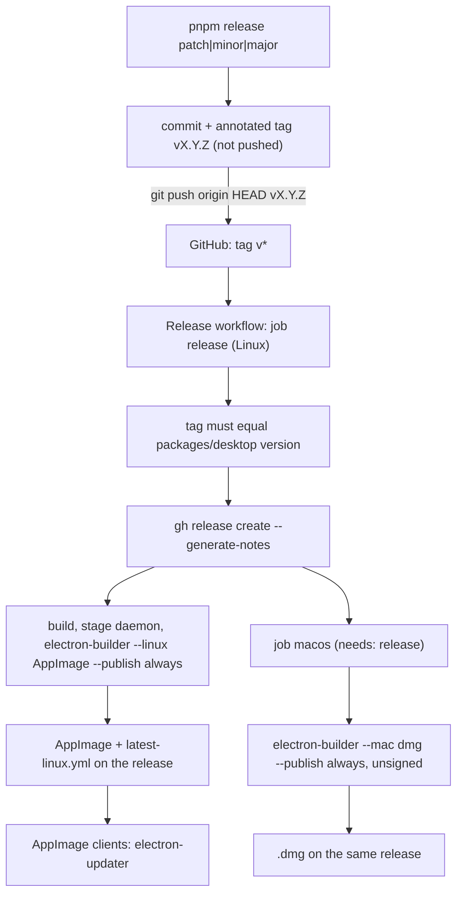

- **Versioning.** `scripts/release.mjs` (`pnpm release <patch|minor|major> [--dry-run]`) bumps only `packages/desktop/package.json`, commits, tags, and never pushes. The workflow fails if the tag and the desktop version differ.
- **Packaging.** `electron-builder.yml`: `asar`, with `node-pty` unpacked; the daemon (the `agents-office` package with production dependencies, prepared by `scripts/stage-daemon.mjs`) is shipped as `resources/daemon` because it runs as a child process. Targets: AppImage and deb on Linux, dmg on macOS, no code signing.
- **Auto-update is Linux AppImage only.** `createUpdateService` in `desktop/src/main/updater.ts` is enabled only when the app is packaged and `APPIMAGE` is set. In any other case (development, `.deb`, macOS) it never touches `electron-updater`. The macOS job also publishes update metadata, but nothing uses it, so macOS and `.deb` are manual installs.
- **Update states** (`UpdateState`): `idle`, `checking`, `available`, `downloading`, `ready`, `error`. The main process pushes them on `agents-office:updater:status`; the web banner offers "restart to update".
- **Clean restart.** Installing goes through the same quit coordinator as "Quit": it asks about active sessions, ends them, then calls `quitAndInstall`.
- **First tag.** No release exists yet, so the macOS job and the end-to-end update path are only truly exercised on the first real tag push.

CI (`.github/workflows/ci.yml`, on pushes to `main` and on pull requests):

| Job | What it does |
| --- | --- |
| `verify` | `pnpm install --frozen-lockfile`, `typecheck`, `lint`, `test`, `build`, then the Playwright suite of `@agents-office/e2e` (web project). Uploads the report on failure. |
| `desktop-linux` | After `verify`: packages the desktop app (`pnpm --filter @agents-office/desktop dist`) and runs the desktop e2e on the packaged app under xvfb; uploads AppImage and deb. |
| `desktop-macos` | After `verify`: unsigned `dist` build; uploads the `.dmg` artifact. |

## Security

The app runs on a developer machine next to their Claude Code credentials and files, so the guarantees are conservative.

- **Loopback only.** The daemon binds `127.0.0.1` and refuses any other host without `--unsafe-host`. The Agent Bus also listens on `127.0.0.1` only. The window loads only the daemon origin; navigation to other origins is denied or sent to the system browser.
- **The daemon has no authentication.** It trusts any local process, which is acceptable because it only exposes the activity model and accepts hook payloads. It does not execute anything, does not return file contents, and the permission messages carry only a short summary.
- **Bearer tokens for the Agent Bus.** One random 32-byte token per session, compared in constant time, scoped to a `BusSession` (session, roster entry, project, role), revoked when the session ends, and gone when the app stops. Unauthenticated calls are rejected.
- **`contextBridge` only.** The window has `contextIsolation` and `sandbox` on and `nodeIntegration` off. The preload exposes one typed global and never `ipcRenderer`. Each IPC handler checks `trusted(event)` (sender is the office window and its frame URL is on the daemon origin) and validates its input with zod.
- **Fail closed.** Spawn approvals deny on timeout, shutdown or any ambiguity; a corrupt approvals file means asking again; an unreadable store starts empty after a backup instead of crashing; the update service stays inert outside an AppImage; the hook CLI swallows every failure so it cannot block Claude Code; role-restricted tools are hidden from other roles and re-checked in the handler, and agents can only message the roster entries they are connected to.
- **No telemetry.** Nothing is sent to any server. The only outbound network use is the update check against GitHub Releases (AppImage only) and whatever the user's own `claude` does.
- **Untrusted content is labelled as data.** Agent messages, whiteboard contents and browser page data are wrapped with notices that they must not be obeyed as instructions. Control characters are stripped from text typed into terminals.
- **Hooks never decide.** The hook command never writes to stdout and never blocks, and permission prompts are only answered in the terminal.
- **Local files.** Persistence stays under Electron's `userData`; writes are atomic and size-limited. `tool_input` is never logged.

## Where does my change go?

| I want to... | Start here |
| --- | --- |
| Show a new kind of Claude Code activity | `daemon/src/normalizer` (produce the event), `shared/src/events.ts` and `reducer.ts`, then the web characters |
| Add a hook event | `shared/src/protocol.ts` (`KNOWN_HOOK_EVENTS`), the normalizer, and `HOOK_EVENTS` in `daemon/src/cli/settings-merger.ts` |
| Change liveness timing | `daemon/src/model/liveness.ts` (`DEFAULT_LIVENESS_CONFIG`) |
| Change how agent types map to professions | `shared/src/professions.ts` |
| Add a daemon route | `daemon/src/server/daemon.ts` |
| Add a desktop capability | contract in `shared/src/desktop*.ts`, `desktop/src/main/*Channels.ts` and `*Ipc.ts`, bridge in `desktop/src/preload`, register in `preload/index.ts`, consumer in `web/src/ui` |
| Add an Agent Bus tool | `desktop/src/main/agentBus` (`BusTool`, with `roles` if restricted), registered in `main.ts` |
| Change terminal behavior | `desktop/src/main/sessionManager.ts` and `ipc.ts` (web side: `ui/terminalPanel.ts`, `ui/terminalTabs.ts`) |
| Change packaging or release | `packages/desktop/electron-builder.yml`, `.github/workflows/release.yml`, `scripts/release.mjs` |
| Change visuals or UI conventions | see [DESIGN.md](./DESIGN.md) |
| Add or change UI text, or add a language | `web/src/i18n/messages/en.ts` (keys), then `pt-BR.ts` and `es.ts`; see DESIGN.md section 6.7 |
| Run, build or test | see [DEVELOPMENT.md](./DEVELOPMENT.md) |
