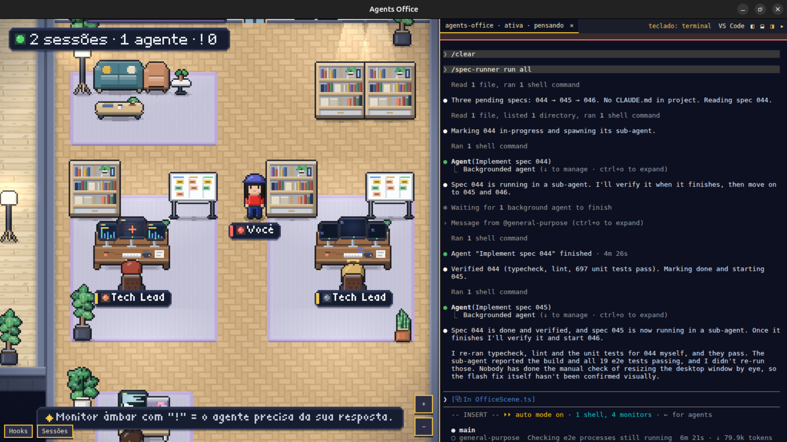

  

<h1 align="center">Agents Office</h1>

A pixel art office that mirrors your <a href="https://claude.com/claude-code">Claude Code</a> agents in real time.

## The idea

Running several Claude Code sessions, each spawning subagents, quickly turns into a wall of
terminals. Agents Office turns that activity into a place you can look at:

- **Each project is a room**, built on the spot the first time the project shows activity, with
  its name on a plaque above the door.
- **Each session is a Tech Lead** at the main desk of its room.
- **Each subagent is an employee** with an IT profession (Analyst, Architect, Dev, QA, Support):
  it walks in, takes a desk, animates according to the tool it is using, delivers its report to
  the Tech Lead when done and leaves.
- **A colored ring** under every character shows whether it is working, thinking, waiting for
  you or in error. Walk up to anyone with your own avatar to see their task, current tool, recent
  steps and token usage.
- **The Hall of Fame** board in the lobby lists the last agents that finished.

It works passively by reading the Claude Code transcripts in `~/.claude/projects`; optional
Claude Code hooks make updates instant and show when an agent is waiting for you. Everything stays
on your machine: the daemon binds `127.0.0.1` only, with no telemetry.

## Install

Download the latest build from the [GitHub Releases page](https://github.com/ailtonloures/agents-office/releases).
Files are named `agents-office-<version>-<os>-<arch>.<ext>`.

### Linux

1. Download `agents-office-<version>-linux-x86_64.AppImage`.
2. Make it executable: `chmod +x agents-office-*-linux-x86_64.AppImage`.
3. Run it: `./agents-office-*-linux-x86_64.AppImage`.

On Debian or Ubuntu you can install the `.deb` instead
(`agents-office-<version>-linux-amd64.deb`): `sudo apt install ./agents-office-*-linux-amd64.deb`.

The AppImage updates itself (the `.deb` does not): when a new release is published, a banner offers to restart into it.

### Optional: Claude Code hooks

For instant updates and "waiting for you" alerts, install the Claude Code hooks with
the CLI (`npx agents-office hooks install`; a backup of `~/.claude/settings.json` is kept;
`hooks uninstall` removes them). Without hooks the office still works by reading
your transcripts.

### Language

The interface is in English by default. The language button in the bottom-left corner bar switches
between English, Portuguese (Brazil) and Spanish; the choice is remembered and the page reloads to
apply it. Text that comes from Claude Code (session content, profile names) is never translated.

### Privacy

Everything stays on your machine. The daemon binds `127.0.0.1` only and there is no telemetry.

## Documentation

- [DEVELOPMENT.md](./DEVELOPMENT.md): run from source, tests and the release process
- [DESIGN.md](./DESIGN.md): visual identity and design decisions
- [ARCHITECTURE.md](./ARCHITECTURE.md): how the pieces fit together

## Agent profiles and the cast

In the desktop app, the **Cast** button opens the cast panel. A *profile* (name, appearance,
instructions, permission mode, model) lives in a global library; a project's *cast* lists the
profiles that run there. Starting a cast member opens a managed Claude Code session whose system
prompt carries the profile instructions and its saved notes, and the agent shows up in the office
with the profile's look. With **auto-reopen** on (the default), the cast is started again every
time the app opens.

Managed sessions get a local **Agent Bus**: an MCP server bound to `127.0.0.1` on an ephemeral
port, with a per-session bearer token that is revoked when the session ends. Its first tool,
`save_notes`, lets the agent keep notes that come back on the next start. Profiles, rosters and
notes are stored under the app's user data folder; nothing leaves your machine.

## Embedded browser

In the desktop app, the **Navegador** button opens a browser tab in the terminal dock, one browser
per workspace (its own cookies and storage, kept between sessions; "Clear data" wipes them). The
page is a native view, so dialogs drawn by the office are hidden behind it.

Managed agents can drive that browser through the Agent Bus tools `browser_navigate`,
`browser_click`, `browser_type`, `browser_press_key`, `browser_wait_for`, `browser_snapshot`,
`browser_screenshot`, `browser_console` and `browser_eval`. While an agent uses it the toolbar says
who is driving, actions of different agents are queued, and the avatar stays at its computer
looking at the monitor. Safety rules:

- Page content is treated as untrusted data and is never executed as instructions.
- Only `http(s)` and `about:blank` open; downloads, site permissions and `browser_eval` each ask
  for **Permitir / Negar** on a card (denied on timeout, nothing is remembered).
- **Pausar agentes** stops every browser tool of the workspace at once.
- **Selecionar elemento** lets you click an element on the page and send its selector, text and
  HTML to a running terminal after you review it; nothing is sent without your click.

## License

[MIT](LICENSE). Logo and default skin assets: CC0 1.0.
